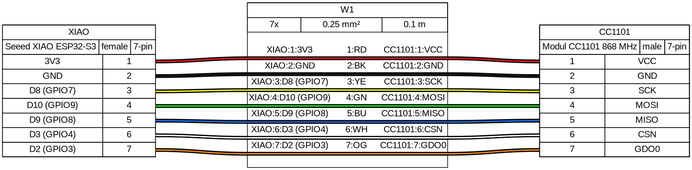

# 2. Instalacja

Zakładam, że masz Home Assistanta i że umiesz lutować kilka przewodów.

## Połączenie modułów

Numery 1–7 na schemacie to tylko kolejność na rysunku, nie numery pinów. Znaczenie ma opis obok.

| CC1101 | XIAO ESP32-S3 |
|---|---|
| VCC | 3V3 (**nie 5V**, CC1101 to układ 3,3 V) |
| GND | GND |
| SCK | D8 (GPIO7) |
| MOSI | D10 (GPIO9) |
| MISO | D9 (GPIO8), na module bywa opisany MISO/GDO1 |
| CSN | D3 (GPIO4) |
| GDO0 | D2 (GPIO3) |
| GDO2 | nie podłączaj |

Podłącz antenę 868 MHz do CC1101 i antenkę u.FL do XIAO.

## Kroki

1. Zainstaluj w Home Assistancie dodatek **ESPHome Device Builder**, albo na komputerze `pip install esphome`.
2. Skopiuj `firmware/secrets.yaml.example` jako `firmware/secrets.yaml` i wpisz własne wartości. Klucz API wygenerujesz poleceniem `openssl rand -base64 32`. Bez wpisanych sekretów budowanie zatrzyma się z błędem o brakującym `secrets.yaml`.
3. Wybierz plik: `firmware/wodomierze.yaml` (jeden licznik) albo `firmware/wodomierze-dwa-liczniki.yaml` (dwa). Na razie zostaw przykładowe `meter_id` i `meter_offset`, wpiszesz je w [rozdziale 3](03-konfiguracja.md).
4. Podłącz XIAO kablem USB-C do komputera i wgraj firmware: `esphome run firmware/wodomierze.yaml`, wybierz port USB. Oczekiwany wynik: `Successfully uploaded program` i logi płytki.
5. Po restarcie płytka łączy się z WiFi. Dalsze wgrania idą już po WiFi (OTA).
6. W Home Assistancie: **Ustawienia → Urządzenia i usługi**. Urządzenie „Wodomierze" powinno pojawić się samo jako wykryte. Kliknij **Skonfiguruj** i wklej klucz z `secrets.yaml`.
7. Ustaw w routerze stały adres IP dla płytki (rezerwacja DHCP), żeby nie zmieniał się po restarcie.

Zasilanie: wystarczy ładowarka USB albo port USB serwera. Do tego nie jest potrzebne żadne przekazywanie portu USB do HA, bo płytka rozmawia z HA przez WiFi.

Dalej: [3. Konfiguracja](03-konfiguracja.md)
